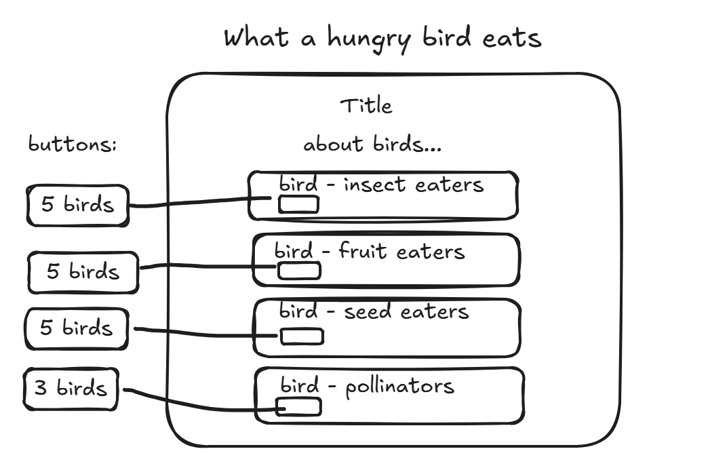

# What to feed a hungry bird

## Problem
To help nature lovers find a bird's diet

## The plan

### Data
Dataset: `birds-of-the-world`

| Field | Example value |
| --- | --- |
| `id` | 1 |
| `Name` | American Goldfinch |
| `Scientific Name` | Spinus Tristis |
| `Conservation Status` | Least Concern |
| `Primary Color` | Yellow |
| `Diet`| seeds, insects |
| `Image of Range` | https://upload.wikimedia.org/wikipedia/commons/thumb/7/72/American_Goldfinch-rangemap.png/330px-American_Goldfinch-rangemap.png
| `Image of Bird` | https://www.allaboutbirds.org/guide/assets/photo/63737371-480px.jpg

 Fields my page shows:

 ### Sections
 -a visitor sees a page about birds and their food source.

 ### User actions
 - a visitor clicks a button to get a random list of birds that eat a particular food source.

 ## Team
 Accountability partner: @Anastasia-2012
## What changed
 Visitor input options

 ## Where the data comes from

 "https://student-data-api.cindino45.workers.dev/api/v1/datasets/birds-of-the-world/records?limit=20

## Links
- Live: https://cindyhackathon.netlify.app

- Repo: https://github.com/SnDyMrn13/hackathon

